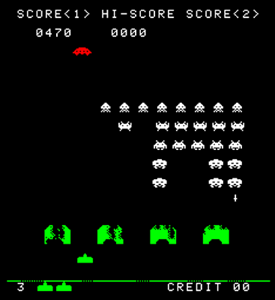

# Invaders360
<sub>AKA every time I try writing C with Microsoft APIs it ends up being C++</sub>

Invaders360 is an arcade emulator of the 1978 Space Invaders for the Xbox 360.



## Status

**Working:**

- 1 player game
- Sounds
- Color overlay

**TODO:**

- 2 player game
- High score persistence
- Better input and sound handling
- Better GPU drawing. Right now the game screen is redrawn to a texture, which is then rendered by the GPU.

## Controls
- Y - Coin
- B - 1 player game
- A - Shoot
- D-Pad left / right - move left / right

## Building

Visual Studio 2010 with the Xbox 360 SDK is required. Use the Release profile for building. Visual Studio can deploy the game to the console with all the necessary files.

### Files

The emulator needs two files next to the `.xex` executable:

- `sounds.pak` - Sounds resembling the original are provided in `res/sounds.pak`
- `invaders.rom` - **Not included, you must bring your own ROM**

When deploying from Visual Studio, the ROM is expected at `res/invaders.rom`. When copying files manually or running from an emulator, place `sounds.pak` and `invaders.rom` in the same directory as the `.xex`.

Additionally, `invaders.rom` must be a merged ROM. If your ROM is split, merge it first:

```
cat invaders.h invaders.g invaders.f invaders.e > invaders.rom
```

### Custom sounds

You can build your own `sounds.pak` with the `sound_packer` script. It expects files `0.wav` .. `8.wav` numbered in the order the sounds appear on the output ports (see the [hardware documentation](https://computerarcheology.com/Arcade/SpaceInvaders/Hardware.html)). The emulator expects 8 bit mono PCM wave files.

```
python sound_packer.py [input_dir] [output_file]
```

## Thanks to

* [Computer Archeology](https://computerarcheology.com/Arcade/SpaceInvaders/Hardware.html) for the Space Invaders hardware documentation
* [superzazu](https://github.com/superzazu/) for a nice 8080 implementation
